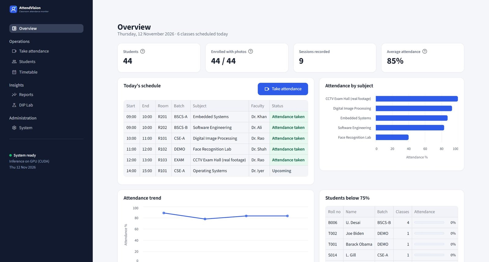
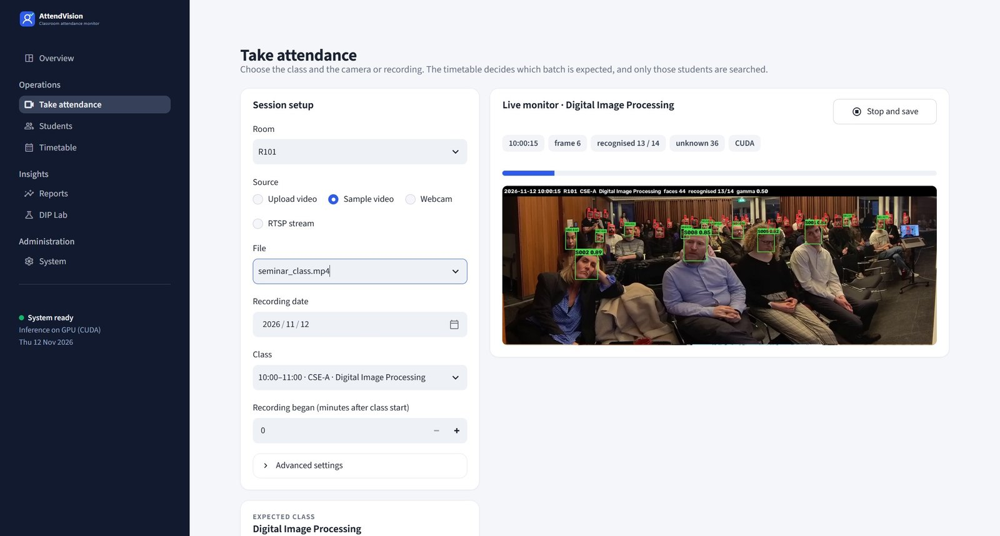
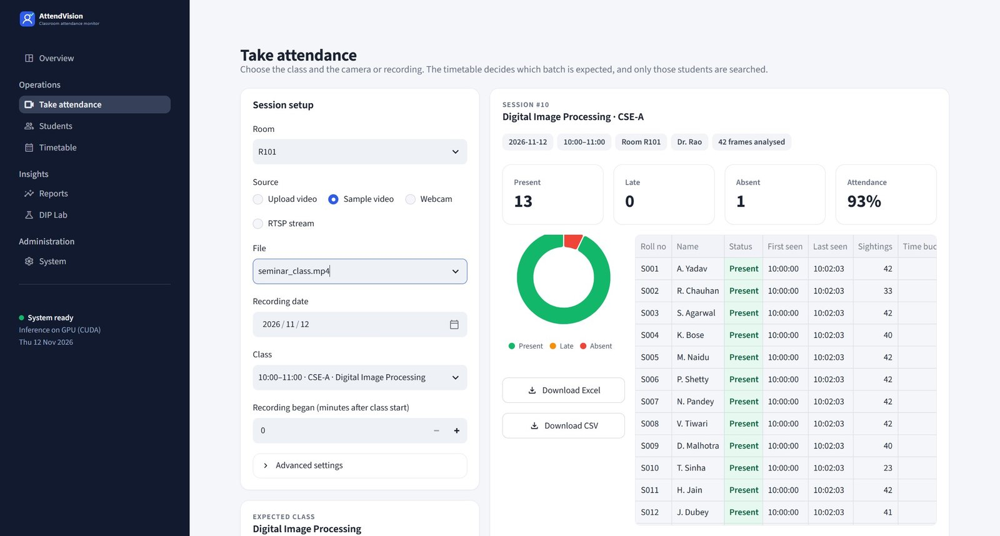
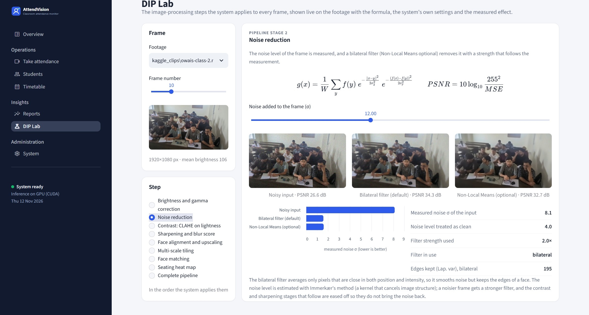

# CCTV Face-Recognition Attendance System

A Digital Image Processing project. The timetable says which batch should be in a room at a
given time; the classroom video is enhanced, faces are detected and matched against that batch's
enrolled photos, and each student is marked Present, Late or Absent automatically.



**Team:** Anoop Singh, Anish Kumar, Shreya Savaliya, Shivangi Sharma, Sumit Chakraborty

- Full write-up with figures and measurements: [docs/REPORT.md](docs/REPORT.md)
- Slides: [docs/DIP_Project_Presentation.pptx](docs/DIP_Project_Presentation.pptx)

## Contents

1. [What it does](#what-it-does)
2. [Results at a glance](#results-at-a-glance)
3. [Quick start](#quick-start)
4. [The dashboard](#the-dashboard)
5. [Using it for a real class](#using-it-for-a-real-class)
6. [How it works](#how-it-works)
7. [Demo data](#demo-data)
8. [Evaluation and tests](#evaluation-and-tests)
9. [Project layout](#project-layout)
10. [GPU notes](#gpu-notes)
11. [What is not in the repository](#what-is-not-in-the-repository)
12. [Limitations](#limitations)
13. [Sources and credits](#sources-and-credits)

## What it does

- **Image enhancement** of every sampled frame: automatic gamma correction from the histogram,
  noise-adaptive bilateral denoising, CLAHE on the L channel of LAB, and unsharp masking.
- **Tiled face detection** (SCRFD) so that small back-row faces are found.
- **Face recognition** (ArcFace) against the students of the scheduled batch only.
- **Attendance rules** that need repeated sightings spread over the class, so one wrong match
  cannot mark a student present.
- **Dashboard** to run a session on a recording, webcam or RTSP stream, manage students and the
  timetable, read reports and export Excel.
- **Seating heat map** for every session: a pseudo-colour map of where faces were seen.
- **DIP Lab** page that demonstrates every unit of the course syllabus live on the footage.

The face detector and recogniser are pretrained models used as they are. The project's own work
is the image-processing pipeline, the matching and attendance logic, the dashboard and the
evaluation.

## Results at a glance

| Measurement | Result |
|---|---|
| Face verification on the LFW benchmark (500 pairs) | 99.4%, no false accepts |
| Labelled students in the classroom dataset whose face was detected (4,603 people) | 90.6% |
| Strangers accepted as a student, class of 40, at the match threshold | 0.00% |
| Faces found in a seminar frame: full frame only vs with tiles | 23 vs 41 |
| Time per 1080p frame with tiling: GTX 1050 vs CPU | 0.36 s vs 2.0 s |
| Recognition after JPEG compression: quality 70 / 40 / 20 | 98.5% / 96.0% / 85.0% |
| Automated tests | 99, all passing |

Details, per-condition tables and the cases where it fails are in the report.

## Quick start

Developed and tested on Python 3.14 on Windows. An NVIDIA GPU is optional.

```
python -m pip install -r requirements.txt
```

No NVIDIA GPU? Replace the two `onnxruntime-gpu` / `nvidia-cudnn` lines in `requirements.txt`
with plain `onnxruntime` first.

**1. Models.** Download `buffalo_l.zip` from the
[InsightFace v0.7 release](https://github.com/deepinsight/insightface/releases/download/v0.7/buffalo_l.zip)
and put two files from it in `models/`: `det_10g.onnx` and `w600k_r50.onnx`. They are run directly
with onnxruntime; the `insightface` package is not needed.

**2. Local data files.** These hold personal data, so the repository ships templates only:

```
copy data\students.example.csv data\students.csv
copy data\cameras.example.csv data\cameras.csv
```

**3. A small public test set** (four portraits and a short clip):

```
python scripts/get_sample_video.py --test-set
python scripts/enroll.py
python scripts/run_session.py --room R102 --start "2026-11-12 11:00" --video data/samples/test_set/hamilton_clip.mp4 --every 1
```

**4. The dashboard:**

```
python -m streamlit run app.py
```

## The dashboard

| Page | What it is for |
|---|---|
| Overview | Today's timetable with status, attendance by subject, trend, students below 75% |
| Take attendance | Choose room, class and source; watch the annotated video; read the result |
| Students | Roster with photos, search, photo upload or camera capture, each student's record |
| Timetable | Weekly grid, slot editor, room cameras |
| Reports | Attendance by student and by subject, session archive, Excel export |
| DIP Lab | Each image-processing topic demonstrated on a chosen frame |
| System | Inference device, model files, storage, thresholds in force |





### DIP Lab

Twenty topics grouped by the six units of the course syllabus. Each has its formula, adjustable
parameters, before/after images, charts and measurements, and says whether it is a pipeline stage
or shown for analysis.

| Unit | Topics |
|---|---|
| 1 Image fundamentals | Sampling and quantization |
| 2 Enhancement, spatial and frequency | Intensity transformations, histogram processing, sharpening and the blur measure, frequency domain, homomorphic filtering |
| 3 Restoration and colour | Noise and spatial filtering, inverse and Wiener filtering, colour models, pseudo-colour |
| 4 Compression and morphology | Huffman / arithmetic / LZW coding, JPEG, morphological processing |
| 5 Segmentation | Point, line and edge detection; thresholding and region growing; Hough transform and boundaries |
| 6 Recognition and case study | Recognition as classification, geometric transforms, multi-scale tiling, the complete pipeline |

Not every technique helps attendance, and the page says so where it was measured: homomorphic
filtering did not raise detection, and the morphological head count is unreliable in a classroom.



## Using it for a real class

1. Edit `data/timetable.csv` (`day,start,end,room,batch,subject,faculty`) and `data/cameras.csv`
   (`room,source,description`; the source is a webcam index or an RTSP address).
2. Add students to `data/students.csv` (`roll_no,name,batch`) with 3 to 5 clear photos each in
   `data/faces/<roll_no>/`, then run `python scripts/enroll.py`. The Students page does the same.
3. Recorded class:
   `python scripts/run_session.py --room R101 --start "2026-11-12 10:00" --video class.mp4`
4. Live class, running until the slot ends: `python scripts/run_session.py --room R101 --live`
5. Reports are written to `outputs/reports/`, snapshots to `outputs/snapshots/session_<id>/`.

Options of `run_session.py`:

| Option | Meaning |
|---|---|
| `--every N` | Seconds between analysed frames (default 3) |
| `--save-video FILE` | Write the annotated frames to a video |
| `--timelapse N` | The file is a time-lapse: N real seconds per frame |
| `--late-after M` | Minutes after the start that count as Late (default 10) |
| `--duration S` | Stop a live run after S seconds |
| `--batch X` | Run for batch X when no class is scheduled |
| `--source S` | Override the room's camera with a webcam index or RTSP address |
| `--no-enhance` | Skip the enhancement stage |

## How it works

### Processing one frame

1. Luminance histogram gives the mean brightness; a dark frame gets gamma correction chosen to
   bring the mean to the target.
2. The noise level is estimated and sets the strength of the bilateral (or Non-Local Means) filter.
3. CLAHE on the L channel of LAB, then unsharp masking; both are eased off on noisy frames.
4. SCRFD runs on the full frame and on overlapping tiles; the results are merged with
   non-maximum suppression.
5. Each face is aligned to 112×112 by a similarity transform on five landmarks. Small faces are
   Lanczos-upscaled first, and crops with a very low Laplacian variance are rejected.
6. Detection uses the enhanced frame, but the ArcFace embedding is taken from the original
   pixels, because measured accuracy is lower on contrast-stretched crops.
7. A face matches a student when the cosine similarity is at least 0.35 (0.32 for blurry crops)
   and beats the second-best student by 0.06. A student is given to at most one face per frame.
8. Faces that match nobody are grouped per person and saved as unknown faces.

### Attendance rules

| Status | Rule |
|---|---|
| Present | Seen at least 3 times, in at least 30% of the time buckets |
| Late | As Present, but first seen more than 10 minutes after the start |
| Absent | Otherwise |

The observed class time is split into 10 equal buckets (slot start to slot end, or to the end of
the recording if that is shorter). Every threshold is in `config.yaml`.

## Demo data

| Batch | Room | Source | What it shows |
|---|---|---|---|
| BSCS-A, BSCS-B | R201, R202 | Kaggle Classroom Student Engagement Dataset | Enrol from one class recording, mark attendance on other recordings of the same class |
| BSCS-B | R202 | The same dataset, three recordings joined as a 40-minute time-lapse | Late at the real 10-minute threshold |
| EXAM | R103 | Altima IP-camera exam-hall clip (720p) | Real overhead CCTV, small faces looking down |
| CSE-A | R101 | Seminar audience cropped from a 4K public video | 40 people, dim room, tiled detection |
| DEMO | R102 | ageitgey/face_recognition examples | Enrolment from separate portraits |

Rebuild from the raw downloads (the Kaggle dataset is unpacked into
`data/samples/kaggle/engagement/`):

```
python scripts/get_sample_video.py --test-set
python scripts/build_clips_from_frames.py --frames data/samples/kaggle/engagement/dataset/images --out data/samples/kaggle_clips
python scripts/auto_enroll_from_video.py --video data/samples/kaggle_clips/owais-class-1.mp4 --batch BSCS-A --prefix A --every 1 --min-face 30 --min-samples 6 --photos 10
python scripts/auto_enroll_from_video.py --video data/samples/kaggle_clips/taimoor-class-2.mp4 --batch BSCS-B --prefix B --every 1 --min-face 30 --min-samples 6 --photos 10
python scripts/apply_names.py
python scripts/simulate_late_arrival.py --video data/samples/kaggle_clips/composite_long_class.mp4 --roll B002 --until 20
python scripts/rebuild_demo_sessions.py --yes
```

Things to state when presenting the demo:

- **Demo classes are enrolled from video.** `auto_enroll_from_video.py` groups the faces of one
  recording into students with DBSCAN, so the pipeline can be shown on footage of people who were
  never photographed. Real students are enrolled from photos.
- **Both Late students are simulated.** `simulate_late_arrival.py` hides one face for the first
  part of a clip. The long BSCS-B class is three separate recordings played as one.
- **Student names are invented** (`data/demo_names.csv`), because the people in the public
  footage are not identified. Pass your own `roll_no,name` CSV to `scripts/apply_names.py` for a
  real class list.

## Evaluation and tests

```
python -m pytest                        # 99 tests, about a minute and a half
python scripts/evaluate.py              # verification accuracy on LFW in 16 conditions
python scripts/evaluate_open_set.py     # threshold choice for a class-sized gallery
python scripts/evaluate_dataset.py      # detection and identification against the dataset's labels
python scripts/evaluate_syllabus.py     # homomorphic, head count, JPEG, restoration, quantization, lossless coding
python scripts/dip_demo.py --video data/samples/kaggle_clips/owais-class-2.mp4 --at 10
python scripts/rebuild_demo_sessions.py # re-run every demo session
```

The tests cover the image-processing operations, timetable and database, the attendance rules
(with a scripted fake face engine, so each rule is checked exactly), the real models, and every
dashboard page and action. Tests that need the models or the sample files are skipped when those
are missing. Set `DIP_CONFIG` to point the code at another `config.yaml`.

## Project layout

| Path | Role |
|---|---|
| `src/preprocess.py` | Pipeline operations: gamma, histogram, filters, CLAHE, sharpening, DFT, homomorphic filter, interpolation, tiles |
| `src/dip_ops.py` | The rest of the syllabus: sampling and quantization, restoration, pseudo-colour, Huffman / arithmetic / LZW / JPEG, morphology, segmentation, Hough |
| `src/face_engine.py` | SCRFD decoding (strides 8/16/32, 2 anchors), NMS, tiled detection, alignment, ArcFace embedding |
| `src/timetable.py` | Room and time to class slot, including slots that cross midnight |
| `src/database.py` | SQLite: students, embeddings, sessions, attendance, unknown faces |
| `src/attendance.py` | Matching, per-frame processing, attendance rules, recorded and live runners, export |
| `app.py`, `ui/` | Dashboard shell and one module per page, plus `theme.py` and `common.py` |
| `scripts/` | Command-line tools: enrol, run a session, evaluate, build demo data |
| `tests/` | Unit tests, real-model tests and headless dashboard tests |
| `config.yaml` | Every threshold and setting |
| `data/` | Timetable, name list and templates; local data files are not tracked |
| `docs/` | Report, presentation, figures and result tables |
| `.streamlit/`, `assets/` | Colour theme and logo |

## GPU notes

The engine uses CUDA automatically when `onnxruntime-gpu` is installed and falls back to CPU
otherwise; `models.use_gpu: false` in `config.yaml` forces CPU.

For a GTX 10xx (Pascal) card the pinned versions in `requirements.txt` matter:
`onnxruntime-gpu` 1.24.4 (CUDA 12) with `nvidia-cudnn-cu12` 9.10.2.21. Newer releases target
CUDA 13 or ship a cuDNN without Pascal kernels and fail at the first convolution with "no kernel
image is available". The CUDA runtime comes from pip packages, so no separate CUDA install is
needed. Do not install `onnxruntime` and `onnxruntime-gpu` side by side.

Setting `detection.tiled: false` is roughly five times faster, at the cost of small faces.

## What is not in the repository

`.gitignore` keeps these out of version control:

| Not tracked | Why | How to get it |
|---|---|---|
| `data/faces/`, `data/attendance.db`, `outputs/` | Face photos, embeddings, attendance records and snapshots are personal data | Created when you enrol students and run sessions |
| `data/students.csv` | The real class list | Copy `data/students.example.csv` |
| `data/cameras.csv` | RTSP addresses can contain passwords | Copy `data/cameras.example.csv` |
| `models/` | 190 MB of model files | Download as in Quick start |
| `data/samples/`, video files | Datasets and footage, several GB | Download as in Demo data |
| `tools/` | ffmpeg binary copied for yt-dlp | Created by `get_sample_video.py` |

Face data is biometric. Enrol people only with their consent. The figures and screenshots in
`docs/` show people from public datasets and footage; cite the sources below when presenting.

## Limitations

- Tested on recorded datasets and one laptop webcam. RTSP was verified with a software stream
  source, not a physical IP camera.
- No attendance register was available for the recordings, so an Absent can be a real absence
  or a missed face.
- Faces under about 20 pixels, turned away, or looking down are often missed.
- The match thresholds were tuned on LFW, which is mostly frontal photographs.
- No liveness check: a printed photo held to the camera would be accepted.
- Homomorphic filtering, restoration and the morphological head count are implemented and
  measured but did not improve attendance, so the pipeline does not use them.

## Sources and credits

- InsightFace `buffalo_l` models: SCRFD-10G detector and ArcFace R50 recogniser (release v0.7).
- Labeled Faces in the Wild (LFW), University of Massachusetts Amherst.
- Classroom Student Engagement Dataset by Ghulam Mustafa, Kaggle, CC BY-NC 4.0.
- "Altima IP Camera Class Room" and "Virtual Reality (VR) Public Speaking Practice Stage:
  Audience of 100", YouTube.
- Example images and clip from the `ageitgey/face_recognition` repository.
