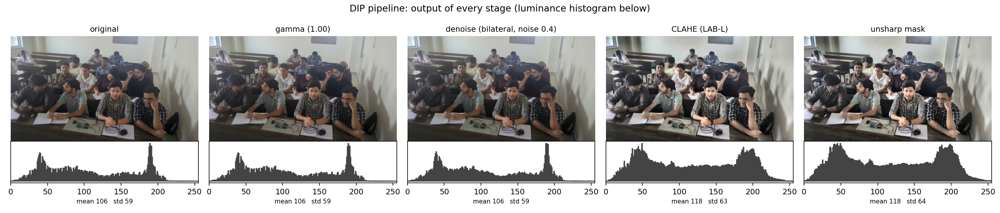
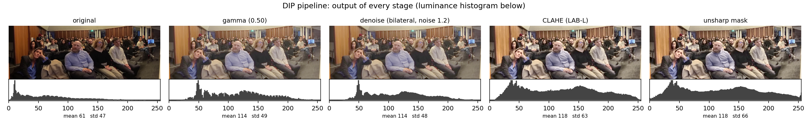
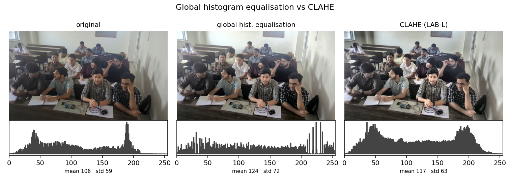
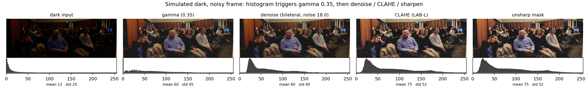
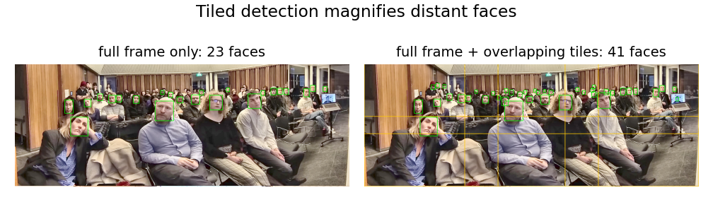
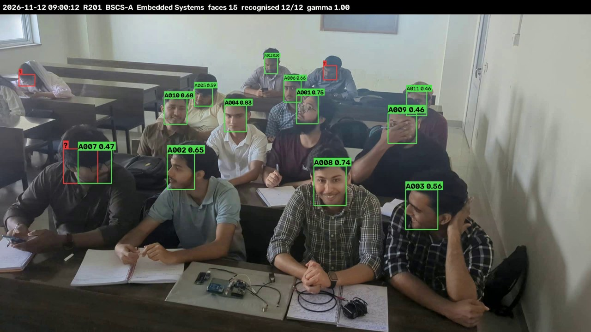
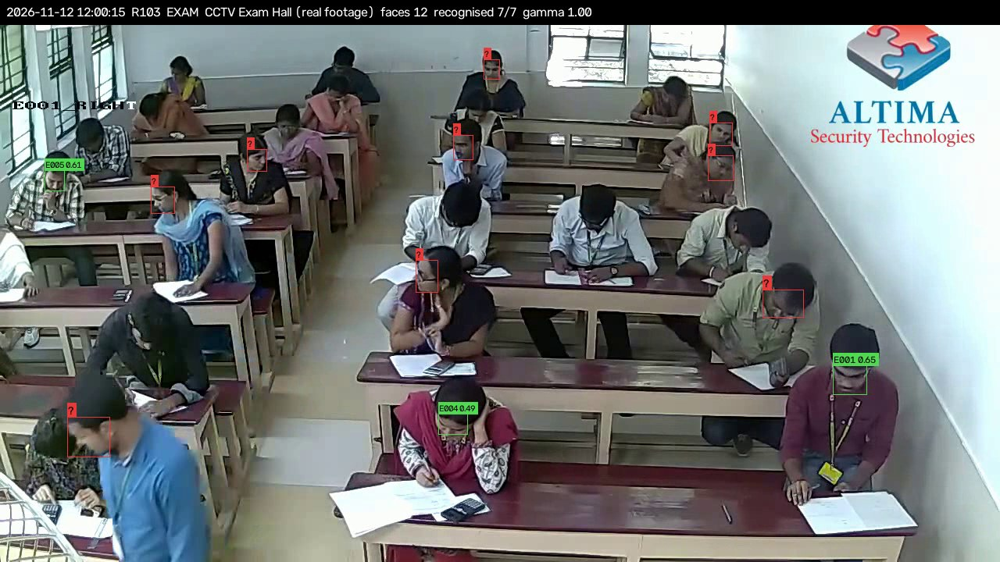

# CCTV Face-Recognition Attendance — Project Report

Digital Image Processing project. All numbers below were measured on this machine
(GTX 1050 4 GB, onnxruntime-gpu 1.24.4) and can be reproduced with the commands given.

## 1. Objective

Mark class attendance automatically from the classroom camera. The timetable decides which
batch should be in a room at a given time; the video is processed, the faces seen are matched
against that batch's enrolled photos, and each student is marked Present, Late or Absent.

## 2. System overview

```
timetable.csv ──(room, time)──► slot ──► batch gallery (SQLite)
                                              │
video / webcam / RTSP ─► sample 1 frame / N s ─► DIP enhancement ─► tiled SCRFD detection
        ─► 5-point alignment (112×112) ─► ArcFace embedding ─► match ─► sightings per student
        ─► Present / Late / Absent ─► SQLite, Excel / CSV, snapshots, dashboard
```

| Part | Implementation |
|---|---|
| Detector | SCRFD-10G (`det_10g.onnx`), decoded by hand: strides 8/16/32, 2 anchors per cell, NMS |
| Recogniser | ArcFace R50 (`w600k_r50.onnx`), 512-d L2-normalised embedding, cosine similarity |
| Runtime | onnxruntime (CUDA with CPU fallback); no `insightface` package |
| Storage | SQLite: students, embeddings, sessions, attendance, unknown faces |
| Interface | Streamlit dashboard and command-line scripts |

## 3. Image-processing pipeline

Every sampled frame passes through these stages (`src/preprocess.py`).

| # | Stage | Method | Purpose |
|---|---|---|---|
| 1 | Brightness | 256-bin luminance histogram → mean; if below 95, gamma = log(125/255) / log(mean/255), clamped to [0.35, 1] | Recover dark rooms |
| 2 | Denoising | Immerkær noise estimate, then bilateral filter (or Non-Local Means) whose strength follows the estimate | Brightening amplifies sensor noise |
| 3 | Contrast | CLAHE on the L channel of LAB (clip 2.0, 8×8 grid) | Local contrast without colour shift |
| 4 | Sharpening | Unsharp mask: img + a·(img − Gaussian(img)) | Edge definition for the detector |
| 5 | Face crops | Lanczos-4 upscale of faces under 112 px, Laplacian-variance blur score | Reject unusable crops; lower threshold for blurry ones |
| 6 | Tiling | 3×2 overlapping tiles (25% overlap) in addition to the full frame | Magnify distant back-row faces |

### 3.1 Stage outputs



*Normally lit classroom (mean 106): gamma is left at 1.00; CLAHE and sharpening act.*



*Dim seminar room (mean 61): the histogram triggers gamma 0.50, raising the mean to 114.*

| Frame | Stage | Mean | Contrast (σ) | Entropy (bits) | Sharpness (Lap. var) |
|---|---|---|---|---|---|
| Classroom | original | 105.6 | 58.8 | 7.41 | 42 |
| | after CLAHE | 118.0 | 63.2 | 7.71 | 100 |
| | after unsharp | 118.0 | 64.0 | 7.73 | 228 |
| Dim room | original | 61.3 | 46.6 | 7.05 | 425 |
| | after gamma 0.50 | 113.8 | 48.5 | 7.40 | 442 |
| | after CLAHE | 118.3 | 62.6 | 7.80 | 886 |
| | after unsharp | 118.4 | 65.5 | 7.88 | 1925 |

### 3.2 CLAHE against global histogram equalisation



Global equalisation stretches the whole histogram (σ 58.8 → 72.1) and over-brightens walls and
windows. CLAHE raises contrast less (σ 63.0) but more usefully: entropy is higher (7.70 against
7.64 bits) because detail is added locally instead of flattening large regions.

### 3.3 Dark, noisy frames



A frame darkened to mean 34 with added noise: gamma 0.35 restores brightness but multiplies the
noise (Laplacian variance 272 → 4510). The noise estimate (σ ≈ 12.5) raises the bilateral
strength, bringing it back to 240 before contrast and sharpening are applied at reduced gain.

### 3.4 Tiled detection



| Footage | Frame | Full frame only | Full frame + tiles |
|---|---|---|---|
| Seminar audience | 1920×704 | 23 faces | **41 faces** |
| Exam-hall CCTV | 1280×720 | 11 faces | **16 faces** |
| Classroom, close shot | 1920×1080 | 12 faces | 12 faces |

Tiling matters when faces are small: the detector input is 640 px, so a 1920-px frame is shrunk
3× in the full-frame pass, while a tile is shrunk only about 1.2×. Faces cut by a tile border are
discarded and recovered whole from the neighbouring tile; duplicates are removed by NMS.

### 3.5 Small face crops


## 4. Recognition accuracy

Measured on **LFW** (Labeled Faces in the Wild), 500 test pairs (246 same person, 254 different),
`python scripts/evaluate.py --pairs 500`. Each image is pasted on a 640×640 canvas so that the
face has a chosen width, as it would inside a camera frame.


| Condition | Both faces detected | Accuracy at system threshold | False accept | False reject |
|---|---|---|---|---|
| Clean, face 110 px | 100% | **99.4%** | 0.0% | 1.2% |
| Face 64 px | 100% | 99.4% | 0.0% | 1.2% |
| Face 40 px | 100% | 99.2% | 0.0% | 1.6% |
| Face 28 px | 100% | 98.6% | 0.0% | 2.8% |
| Face 20 px | 98.4% | 96.0% | 0.0% | 8.1% |
| Face 14 px | 0.4% | 51.0% | 0.0% | 99.6% |
| Dark + noise, 40 px, no enhancement | 100% | 99.2% | 0.0% | 1.6% |
| Dark + noise, detect on enhanced / embed original (system default) | 100% | 98.8% | 0.0% | 2.4% |
| Dark + noise, detect and embed on enhanced | 100% | 96.4% | 0.0% | 7.3% |
| Blurred (σ 1.6), 40 px, no enhancement | 99.6% | 94.4% | 0.0% | 11.4% |
| Blurred, detect and embed on enhanced | 100% | 89.0% | 0.0% | 22.4% |

Threshold 0.40, or 0.35 for the small (≤ 28 px) and degraded conditions. Full table:
[lfw_results.csv](lfw_results.csv).


Findings:

1. **The 0.40 threshold is safe.** No false accept occurred in any condition; the errors are all
   missed matches. Different people score around 0, the same person around 0.6–0.7.
2. **Recognition holds down to about 20 px faces** and collapses at 14 px, where the detector no
   longer finds the face. This is the case tiling addresses: a 14-px face in a 1080p frame is
   about 36 px inside a tile.
3. **Enhancement must not be applied to the crop that is embedded.** Embedding from the enhanced
   image lowers accuracy (99.2% → 96.4% dark, 94.4% → 89.0% blurred), because ArcFace was trained
   on natural images. The system therefore detects on the enhanced frame and embeds from the
   original pixels.
4. **The Lanczos pre-upscale gave no measurable gain** over warping the small face directly
   (differences of 1–4 pairs out of 500, in both directions). It is kept as specified but is not
   the reason small faces work.
5. On these already well-exposed benchmark images the enhancement stage did not raise detection,
   which was already 100%. Its measured benefit is on real footage (section 3.4) and dark frames.

## 5. Attendance logic

- **Gallery restriction.** Only the students of the batch scheduled in that room are compared,
  which shrinks the gallery and removes most chances of a wrong match.
- **Match.** Best similarity ≥ 0.40 (0.35 when the crop's Laplacian variance is under 60), and
  at least 0.06 above the second-best student. Per frame, a student is given to at most one
  face — the one with the highest similarity.
- **Decision.** The observed class time is split into 10 buckets.
  Present: ≥ 3 sightings in ≥ 30% of the buckets. Late: the same, but first seen more than
  10 minutes after the start. Absent: otherwise.
- **Unknown faces** are grouped per person (running-mean embedding, merge at similarity 0.40) and
  saved with a snapshot; single stray detections are dropped.
- **Output.** One best snapshot per student, an Excel workbook (attendance, summary, unknown
  faces) and a CSV per session.

## 6. Results on real footage

`python scripts/rebuild_demo_sessions.py --yes` re-runs every session below.

| # | Footage | Enrolled from | Students | Present | Late | Absent |
|---|---|---|---|---|---|---|
| 1 | University class A, recording 2 | recording 1 | 12 | 12 | 0 | 0 |
| 2 | University class A, recording 3 (wide shot) | recording 1 | 12 | 8 | 0 | 4 |
| 3 | University class B, recording 3 | recording 2 | 6 | 4 | 0 | 2 |
| 4 | University class B, recording 4 | recording 2 | 6 | 5 | 0 | 1 |
| 5 | University class B, recording 5 | recording 2 | 6 | 5 | 0 | 1 |
| 6 | Class B, recordings 3+4+5 as a 40-min time-lapse | recording 2 | 6 | 4 | 1 | 1 |
| 7 | Exam-hall CCTV, last 42 s | first 30 s | 7 | 6 | 0 | 1 |
| 8 | Seminar audience, last 124 s | first 60 s | 14 | 12 | 1 | 1 |
| 9 | Public test clip | separate portraits | 5 | 1 | 0 | 4 |



*Session 1: every enrolled student recognised in a different recording of the same class.*



*Session 7: overhead CCTV, faces about 25 px and mostly looking down.*

Notes on reading this table:

- In sessions 1–6 the class was enrolled from one recording and tested on **different
  recordings**, which is the realistic case. Sessions 7 and 8 use two parts of the same recording.
- There is no ground truth for who attended each recording, so an "Absent" may be a true absence
  or a miss. In session 2 (a wide, distant shot) at least two students were matched a few times
  but stayed under the Present rule, so that session under-counts.
- Session 6 joins three separate recordings into one class to exercise the Late rule at its real
  10-minute threshold: one student, absent from the first recording, is first seen 12 min 40 s in.
- In session 8 the Late student is simulated (face blurred for the first 75 s, threshold lowered
  to 1 minute) and the Absent student is a portrait of someone not in the footage.
- In session 9 one enrolled person appears briefly in the audience (5 sightings) and is correctly
  left Absent by the persistence rule.

**Live mode** was run on the laptop webcam (enrolled user Present in 15 of 15 frames, best
similarity 0.77), on a UDP network stream and on an RTSP stream (13 Present, 1 Absent on the
seminar class).

**Speed** for one 1080p frame with tiling (7 detector passes, 9 faces embedded): 0.36 s on the
GTX 1050 against 1.99 s on CPU. At one frame every 3 s both are faster than real time.

## 7. Testing

`python -m pytest` runs 66 automated tests in about 40 s.

| Area | Tests | What is checked |
|---|---|---|
| Image processing | 11 | gamma trigger and clamp, noise estimate, denoising, CLAHE vs global HE, unsharp, blur score, tile coverage and overlap |
| Timetable and database | 14 | slot lookup and boundaries, midnight-crossing slots, CSV round trip, batch-restricted gallery, cascade deletes |
| Attendance rules | 22 | Present / Late / Absent at each boundary, thresholds, margin, one-face-per-student, unknown merging, export, virtual clock, time-lapse |
| Real models | 11 | alignment maths, NMS, face counts, landmarks, same / different person scores, small faces, tiled detection, enrolment, an end-to-end recorded session |
| Dashboard | 8 | every page loads; navigation, roster search, add / delete student, re-enrol, save timetable and cameras, run a session, reports, delete session |

The attendance rules are tested with a scripted fake face engine, so each rule is checked exactly
rather than inferred from footage. Writing the suite found and fixed a real defect: class slots
running past midnight were never matched.

## 8. Limitations

- **No attendance ground truth.** Recognition accuracy is measured on LFW; attendance on real
  footage is checked by inspection, not against a register.
- **Enrolment in the demo comes from video**, clustered automatically. Real use needs 3–5 photos
  per student, and accuracy on photo-enrolled students seen through a classroom camera was only
  tested for one person on a webcam.
- **Face size.** Below about 20 px recognition degrades, and faces turned away or looking down
  are missed. Camera placement (front of the room, 1080p or better) matters more than any filter.
- **RTSP** was verified with a software stream source, not with a physical IP camera.
- **No liveness check**: a printed photo held to the camera would be accepted.
- **Privacy**: face data is biometric. Consent, retention and access rules are needed before use
  on real students.

## 9. Data and model sources

- InsightFace `buffalo_l` models (SCRFD-10G, ArcFace R50 trained on WebFace600K), release v0.7.
- Labeled Faces in the Wild (LFW), University of Massachusetts Amherst.
- Classroom Student Engagement Dataset, Ghulam Mustafa, Kaggle, CC BY-NC 4.0.
- "Altima IP Camera Class Room" and "Virtual Reality (VR) Public Speaking Practice Stage:
  Audience of 100", YouTube.
- Example images and clip from the `ageitgey/face_recognition` repository.
