# CCTV Face-Recognition Attendance — Project Report

Digital Image Processing project. All numbers below were measured on this machine
(GTX 1050 4 GB, onnxruntime-gpu 1.24.4) and can be reproduced with the commands given.

## 1. Objective

Mark class attendance automatically from the classroom camera. The timetable decides which
batch should be in a room at a given time; the video is processed, the faces seen are matched
against that batch's enrolled photos, and each student is marked Present, Late or Absent.

## 2. System overview

```
timetable.csv ──(room, time)──► slot ──► batch gallery (SQLite)
                                              │
video / webcam / RTSP ─► sample 1 frame / N s ─► DIP enhancement ─► tiled SCRFD detection
        ─► 5-point alignment (112×112) ─► ArcFace embedding ─► match ─► sightings per student
        ─► Present / Late / Absent ─► SQLite, Excel / CSV, snapshots, dashboard
```

| Part | Implementation |
|---|---|
| Detector | SCRFD-10G (`det_10g.onnx`), decoded by hand: strides 8/16/32, 2 anchors per cell, NMS |
| Recogniser | ArcFace R50 (`w600k_r50.onnx`), 512-d L2-normalised embedding, cosine similarity |
| Runtime | onnxruntime (CUDA with CPU fallback); no `insightface` package |
| Storage | SQLite: students, embeddings, sessions, attendance, unknown faces |
| Interface | Streamlit dashboard and command-line scripts |

## 3. Image-processing pipeline

### 3.0 Syllabus coverage

Every unit of the course syllabus is implemented and demonstrated. "Role" says whether the
technique is part of the attendance pipeline or is shown for analysis.

| Unit | Syllabus topic | What is implemented | Role in the system | Section |
|---|---|---|---|---|
| 1 | Image representation, grey and colour | Luminance, BGR, LAB, HSV, YCrCb planes | Pipeline | 3.8 |
| 1 | Sampling and quantization | Spatial subsampling, grey-level quantization | Analysis, with a recognition test | 3.9 |
| 2 | Basic grey-level transformations | Gamma, log, negative, contrast stretching | Pipeline: automatic gamma | 3.1, 3.3 |
| 2 | Histogram processing | Histogram, CDF, global equalisation, CLAHE | Pipeline: contrast stage | 3.2 |
| 2 | Spatial low-pass and high-pass filtering | Mean, Gaussian, median, bilateral, NLM; Laplacian, unsharp mask, Sobel | Pipeline: denoising, sharpening, blur score | 3.6, 3.7 |
| 2 | Frequency-domain smoothing and sharpening | 2-D DFT, ideal / Butterworth / Gaussian low- and high-pass | Analysis | 3.7 |
| 2 | Homomorphic filtering | Log, DFT, high-emphasis filter, exponent | Optional pipeline stage (off: measured, no gain) | 3.10 |
| 3 | Noise models, noise reduction | Gaussian and salt-and-pepper noise, noise estimation, PSNR | Pipeline: noise-adaptive denoising | 3.6 |
| 3 | Inverse and Wiener filtering | PSF and OTF, truncated inverse filter, Wiener filter | Analysis, with a recognition test | 3.11 |
| 3 | Colour models | CIELAB, HSV, YCrCb | Pipeline: contrast on L* only | 3.8 |
| 3 | Pseudo-colour processing | Colour maps, intensity slicing | Pipeline output: session heat map | 3.12 |
| 4 | Huffman, arithmetic, LZW coding | All three coders and decoders, entropy | Analysis | 3.13 |
| 4 | JPEG standard | 8×8 DCT, quantization tables, real codec | Analysis, with a recognition test | 3.13 |
| 4 | Erosion, dilation, opening, closing | With ellipse, rectangle and cross structuring elements | Analysis: head-count experiment | 3.14 |
| 4 | Hole filling, connected components, thinning, skeletons | Flood-fill hole filling, labelling, Zhang-Suen thinning, morphological skeleton | Analysis: head-count experiment | 3.14 |
| 5 | Point, line and edge detection | Laplacian point mask, four line masks, Roberts, Prewitt, Sobel, LoG, Canny | Analysis | 3.15 |
| 5 | Thresholding | Basic global, Otsu, adaptive | Analysis | 3.15 |
| 5 | Region-based segmentation | Seeded region growing | Analysis | 3.15 |
| 5 | Edge linking, boundary detection, Hough transform | Contour following, (ρ, θ) accumulator, line detection | Analysis | 3.15 |
| 6 | Pattern classes, decision-theoretic recognition | Minimum-distance (cosine) classifier with threshold and margin | Pipeline: face matching | 4, 5 |
| 6 | Case study | The attendance system | The project | 6 |
| – | Geometric transforms, interpolation, multi-scale | Similarity transform, four interpolators, overlapping tiles with NMS | Pipeline: alignment and tiled detection | 3.4, 3.5 |

The operations are in `src/preprocess.py` and `src/dip_ops.py`, each covered by unit tests, and
each is demonstrated on the footage in the dashboard's **DIP Lab** page: 20 topics grouped by
unit, with the formula, adjustable parameters, before/after images and measurements.

Every sampled frame passes through these stages (`src/preprocess.py`).

| # | Stage | Method | Purpose |
|---|---|---|---|
| 1 | Brightness | 256-bin luminance histogram → mean; if below 95, gamma = log(125/255) / log(mean/255), clamped to [0.35, 1] | Recover dark rooms |
| 2 | Denoising | Immerkær noise estimate, then bilateral filter (or Non-Local Means) whose strength follows the estimate | Brightening amplifies sensor noise |
| 3 | Contrast | CLAHE on the L channel of LAB (clip 2.0, 8×8 grid) | Local contrast without colour shift |
| 4 | Sharpening | Unsharp mask: img + a·(img − Gaussian(img)) | Edge definition for the detector |
| 5 | Face crops | Lanczos-4 upscale of faces under 112 px, Laplacian-variance blur score | Reject unusable crops; lower threshold for blurry ones |
| 6 | Tiling | 3×2 overlapping tiles (25% overlap) in addition to the full frame | Magnify distant back-row faces |

### 3.1 Stage outputs


*Normally lit classroom (mean 106): gamma is left at 1.00; CLAHE and sharpening act.*


*Dim seminar room (mean 61): the histogram triggers gamma 0.50, raising the mean to 114.*

| Frame | Stage | Mean | Contrast (σ) | Entropy (bits) | Sharpness (Lap. var) |
|---|---|---|---|---|---|
| Classroom | original | 105.6 | 58.8 | 7.41 | 42 |
| | after CLAHE | 118.0 | 63.2 | 7.71 | 100 |
| | after unsharp | 118.0 | 64.0 | 7.73 | 228 |
| Dim room | original | 61.3 | 46.6 | 7.05 | 425 |
| | after gamma 0.50 | 113.8 | 48.5 | 7.40 | 442 |
| | after CLAHE | 118.3 | 62.6 | 7.80 | 886 |
| | after unsharp | 118.4 | 65.5 | 7.88 | 1925 |

### 3.2 CLAHE against global histogram equalisation


Global equalisation stretches the whole histogram (σ 58.8 → 72.1) and over-brightens walls and
windows. CLAHE raises contrast less (σ 63.0) but more usefully: entropy is higher (7.70 against
7.64 bits) because detail is added locally instead of flattening large regions.

### 3.3 Dark, noisy frames


A frame darkened to mean 34 with added noise: gamma 0.35 restores brightness but multiplies the
noise (Laplacian variance 272 → 4510). The noise estimate (σ ≈ 12.5) raises the bilateral
strength, bringing it back to 240 before contrast and sharpening are applied at reduced gain.

### 3.4 Tiled detection


| Footage | Frame | Full frame only | Full frame + tiles |
|---|---|---|---|
| Seminar audience | 1920×704 | 23 faces | **41 faces** |
| Exam-hall CCTV | 1280×720 | 11 faces | **16 faces** |
| Classroom, close shot | 1920×1080 | 12 faces | 12 faces |

Tiling matters when faces are small: the detector input is 640 px, so a 1920-px frame is shrunk
3× in the full-frame pass, while a tile is shrunk only about 1.2×. Faces cut by a tile border are
discarded and recovered whole from the neighbouring tile; duplicates are removed by NMS.

### 3.5 Small face crops

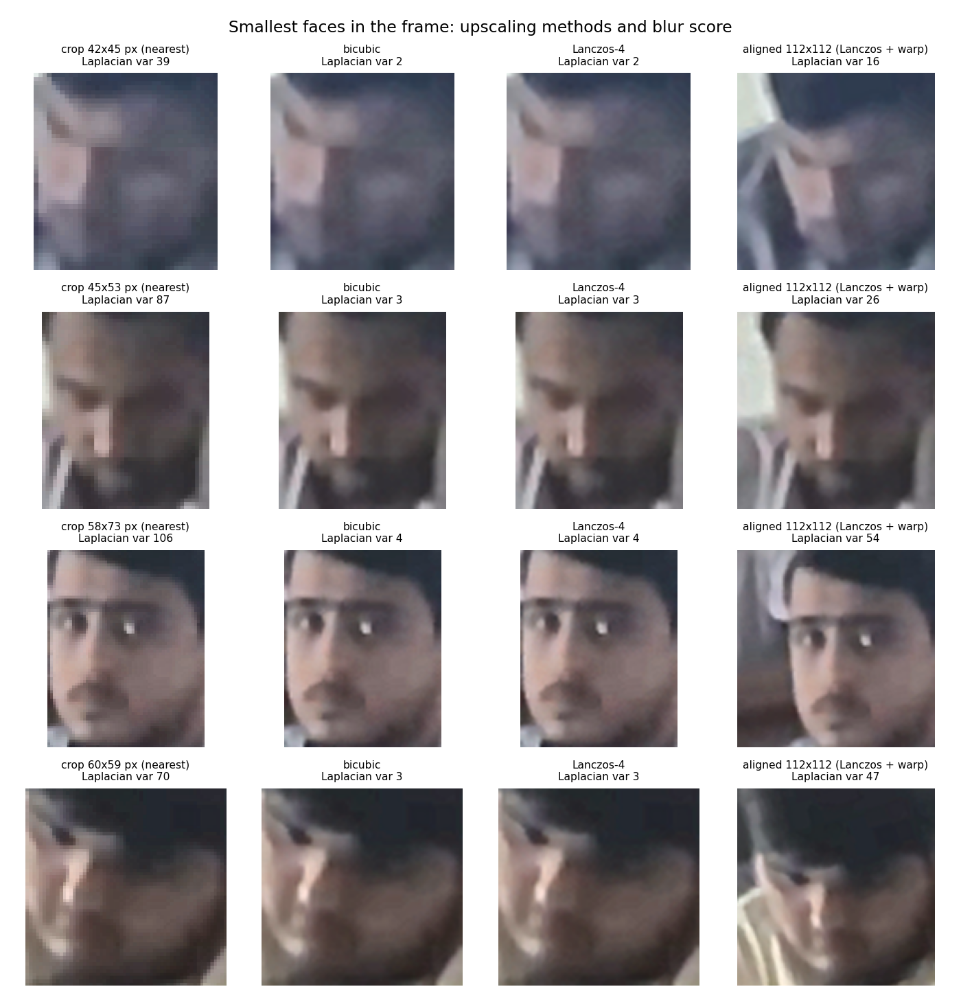

### 3.6 Noise models and spatial filters

Noise of a known kind was added to a clean classroom frame and each smoothing filter was scored by
PSNR against the clean frame, and by how much edge detail it kept (variance of the Laplacian).

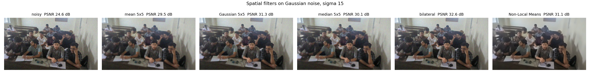

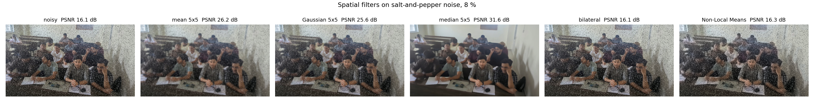

| Filter (5×5) | Gaussian noise σ 15: PSNR | Edges kept (Lap. var) | Salt-and-pepper 8%: PSNR |
|---|---|---|---|
| Mean | 29.5 dB | 21 | 26.2 dB |
| Gaussian | 31.3 dB | 34 | 25.6 dB |
| Median | 30.1 dB | 70 | **31.6 dB** |
| Bilateral | **32.6 dB** | 405 | 16.1 dB |
| Non-Local Means | 31.1 dB | 623 | 16.3 dB |

For Gaussian (sensor) noise the bilateral filter gives the best PSNR and keeps roughly ten times
more edge detail than the linear filters, which is why it is the pipeline's denoising stage: faces
must stay sharp for the detector. For impulse noise the order reverses: the median filter removes
it almost completely, while the edge-preserving filters treat each impulse as an edge and keep it.
CCTV noise in low light is of the first kind.

### 3.7 Frequency domain

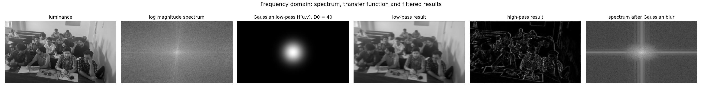

| Image | Energy outside the low-frequency disc | Blur score (Lap. var) |
|---|---|---|
| Original | 1.35% | 350 |
| After Gaussian blur σ 2.5 | 0.42% | 3 |
| After unsharp mask | 2.70% | 1310 |

Blur is a low-pass operation: it removes the outer part of the spectrum, where edges and fine
detail live. The Laplacian is a high-pass operator, so its variance collapses on a blurred image.
That is the basis of the blur score used to discard unusable face crops, and of the unsharp mask,
which adds back a scaled copy of the high-frequency detail. Frequency-domain filtering is used
here for analysis; the pipeline applies the equivalent filters in the spatial domain, where they
are cheaper for small kernels.

### 3.8 Colour model

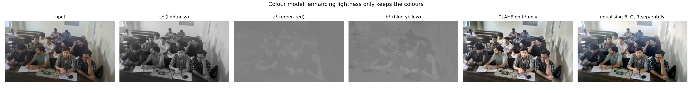

CLAHE is applied to the L* (lightness) channel of CIELAB and the a* and b* colour channels are
left untouched. Equalising B, G and R separately changes the balance between the channels and
tints the image, which also alters skin tones the recogniser depends on.

### 3.9 Sampling and quantization (Unit 1)

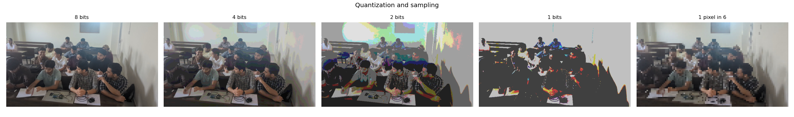

Recognition on 200 LFW pairs (faces 40 pixels wide) as the number of bits per channel is reduced:

| Bits per channel | Grey levels | Verification accuracy | False rejects |
|---|---|---|---|
| 8 | 256 | 99.5% | 1.0% |
| 4 | 16 | 99.5% | 1.0% |
| 3 | 8 | 97.0% | 5.8% |
| 2 | 4 | 82.5% | 34.0% |
| 1 | 2 | 67.5% | 63.1% |

Sixteen grey levels are enough; below eight the false contours destroy the facial detail. The
spatial sampling limit is the face-size result in section 4: recognition holds down to faces
about 20 pixels wide.

### 3.10 Homomorphic filtering (Unit 2)

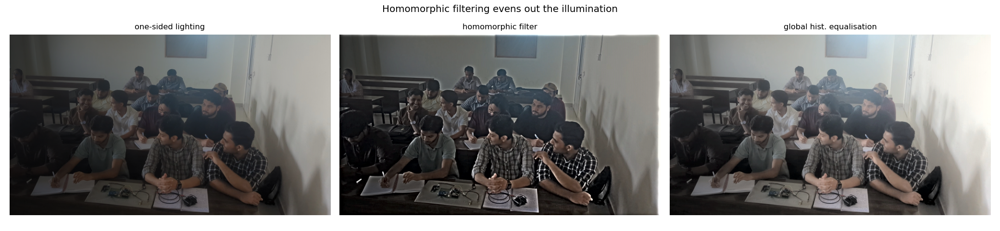

Implemented as a switchable pipeline stage (`preprocess.homomorphic` in `config.yaml`) and
measured against the 1,177 labelled students of every fourth dataset frame, both as recorded and
with a simulated light fall-off from one side:

| Lighting | Stage | Lighting unevenness | Students detected |
|---|---|---|---|
| As recorded | Pipeline | 42.2 | 90.2% |
| As recorded | Pipeline + homomorphic | 27.2 | 88.3% |
| One-sided | Pipeline | 37.1 | 78.7% |
| One-sided | Pipeline + homomorphic | 24.5 | 77.5% |

The filter does what it is designed for: lighting unevenness (the spread of block brightness)
falls by a third. But it does not help the detector, which is slightly worse with it, so the
stage is left off by default. CLAHE already handles local contrast, and the neural detector is
fairly tolerant of slow illumination changes.

### 3.11 Inverse and Wiener filtering (Unit 3)

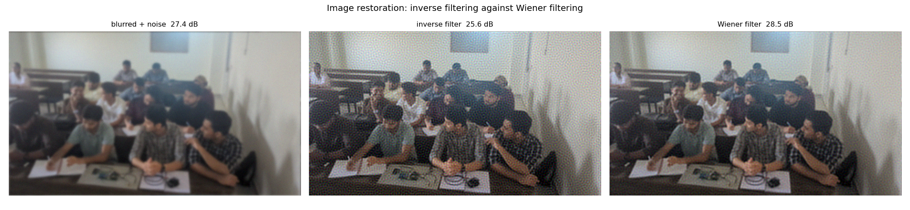

On the frame above (Gaussian blur σ 2 plus noise) inverse filtering lowers the PSNR, because it
divides the noise by small values of H, while the Wiener filter raises it. The same holds for
recognition on 200 LFW pairs blurred with a known PSF (σ 1.6) and noise:

| Restoration before recognition | Verification accuracy | False rejects |
|---|---|---|
| None | 94.0% | 11.7% |
| Inverse filter | 92.5% | 14.6% |
| Wiener filter, K = 0.01 | 96.0% | 7.8% |
| Wiener filter, K = 0.05 | 96.5% | 6.8% |

Wiener filtering recovers part of the loss; inverse filtering makes it worse. This needs the
blur to be known exactly, which a real camera does not provide, so restoration is demonstrated
but not used in the attendance pipeline.

### 3.12 Pseudo-colour: the session heat map (Unit 3)

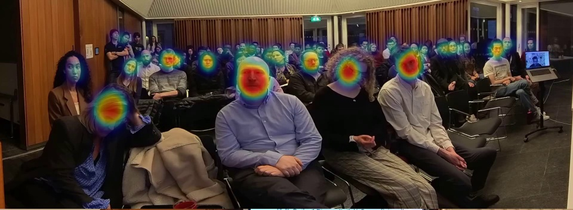

Every attendance session accumulates every detected face, as an ellipse of its own size, on a
coarse grid and saves the result as a pseudo-colour overlay (red = seen in most frames). It is
meaningful for a fixed camera; a camera that moves during the recording smears the map. It shows where students
sat and which seats the camera covers poorly, and appears in the session result under "Seating
heat map". This is the one new technique that became part of the system's output.

### 3.13 Compression (Unit 4)

Lossless coding of one 320×180 grey frame, with the coders written out in `src/dip_ops.py`
(each has a decoder and a test that the round trip is exact):

| Method | Bits per pixel | Compression ratio |
|---|---|---|
| Uncompressed | 8.000 | 1.00 |
| Entropy (lower bound for symbol coding) | 7.429 | 1.08 |
| Huffman coding | 7.463 | 1.07 |
| Arithmetic coding | 7.429 | 1.08 |
| LZW, 12-bit codes | 9.102 | 0.88 |
| PNG (prediction, then LZ77 and Huffman) | 4.407 | 1.82 |

Huffman coding comes within 0.03 bits of the entropy and arithmetic coding reaches it, but a
camera frame uses its grey levels almost evenly, so removing coding redundancy alone gains only
8%. LZW makes the file larger, because a noisy natural image has few repeated strings. PNG does
far better by first predicting each pixel from its neighbours, which removes the spatial
(inter-pixel) redundancy.

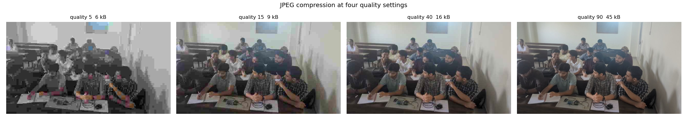

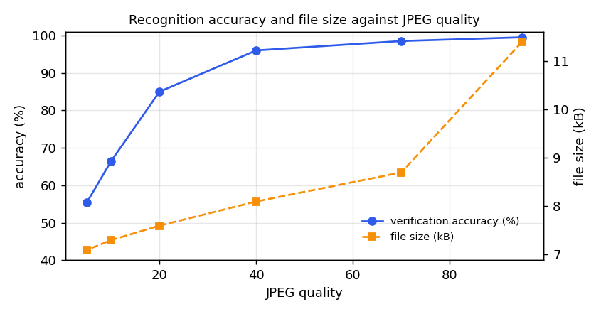

JPEG removes psychovisual redundancy by quantizing the DCT coefficients. Recognition on 200 LFW
pairs after compressing the frame:

| JPEG quality | Verification accuracy | False rejects | Faces detected |
|---|---|---|---|
| 95 | 99.5% | 1.0% | 100% |
| 70 | 98.5% | 2.9% | 100% |
| 40 | 96.0% | 7.8% | 100% |
| 20 | 85.0% | 29.1% | 100% |
| 10 | 66.5% | 65.0% | 100% |
| 5 | 55.5% | 86.4% | 79% |

Recognition is safe down to a quality of about 40 and collapses below 20, even though faces are
still detected. This matters in practice: CCTV recorders set to a low bitrate work in that range.

### 3.14 Morphological processing (Unit 4)

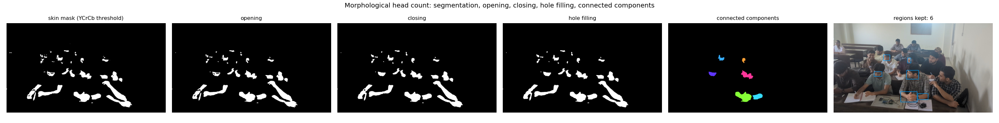

A classical people count was built from the syllabus operations: skin-colour thresholding in
the Cr and Cb planes, opening, closing, hole filling, connected components, and a size and
shape filter. Against the labelled number of students in 121 frames:

| Method | Mean count (true mean 9.73) | Mean absolute error | Correlation with the true count |
|---|---|---|---|
| Skin segmentation + morphology | 5.41 | 4.84 | 0.11 |
| Face detector (SCRFD) | 9.10 | 0.98 | 0.92 |

The classical count is not usable in a classroom: wooden desks, hands and arms are skin-coloured
too, and neighbouring faces merge into one region. It is kept as a demonstration of the
operations and as a measured comparison with the learned detector, and is not used for
attendance. Thinning and skeletons are implemented and demonstrated on the same masks.

### 3.15 Segmentation (Unit 5)

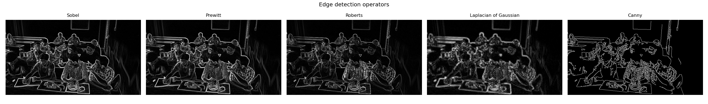

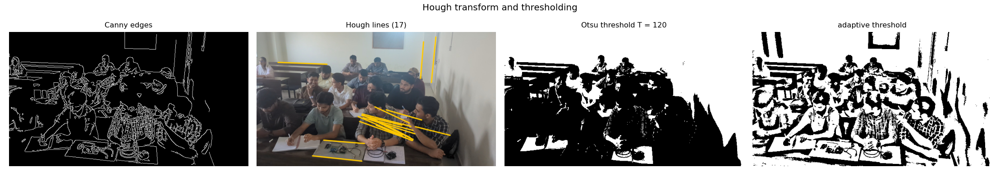

Roberts, Prewitt, Sobel, Laplacian of Gaussian and Canny edge maps, the point and line masks,
basic global / Otsu / adaptive thresholding, seeded region growing, contour following and the
Hough transform are implemented and shown on the footage. In a classroom frame the strongest
Hough lines are desk and bench edges, and their tilt indicates how the camera is rotated. These
are demonstrations: the attendance pipeline segments faces with the learned detector.

## 4. Recognition accuracy

Measured on **LFW** (Labeled Faces in the Wild), 500 test pairs (246 same person, 254 different),
`python scripts/evaluate.py --pairs 500`. Each image is pasted on a 640×640 canvas so that the
face has a chosen width, as it would inside a camera frame.

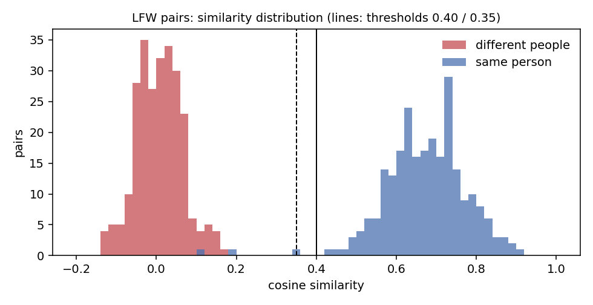

| Condition | Both faces detected | Accuracy at system threshold | False accept | False reject |
|---|---|---|---|---|
| Clean, face 110 px | 100% | **99.4%** | 0.0% | 1.2% |
| Face 64 px | 100% | 99.4% | 0.0% | 1.2% |
| Face 40 px | 100% | 99.2% | 0.0% | 1.6% |
| Face 28 px | 100% | 98.6% | 0.0% | 2.8% |
| Face 20 px | 98.4% | 96.0% | 0.0% | 8.1% |
| Face 14 px | 0.4% | 51.0% | 0.0% | 99.6% |
| Dark + noise, 40 px, no enhancement | 100% | 99.2% | 0.0% | 1.6% |
| Dark + noise, detect on enhanced / embed original (system default) | 100% | 98.8% | 0.0% | 2.4% |
| Dark + noise, detect and embed on enhanced | 100% | 96.4% | 0.0% | 7.3% |
| Blurred (σ 1.6), 40 px, no enhancement | 99.6% | 94.4% | 0.0% | 11.4% |
| Blurred, detect and embed on enhanced | 100% | 89.0% | 0.0% | 22.4% |

This table was measured at the initial thresholds: 0.40, or 0.35 for the small (≤ 28 px) and
degraded conditions. Section 4.1 shows why they were then lowered. Full table:
[lfw_results.csv](lfw_results.csv).

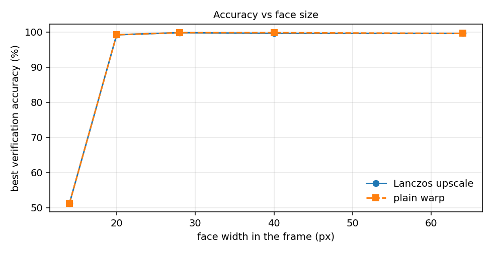

Findings:

1. **The 0.40 threshold is safe but too strict.** No false accept occurred in any condition; the
   errors are all missed matches. Different people score around 0, the same person around
   0.6–0.7, and the best-separating threshold is near 0.2.
2. **Recognition holds down to about 20 px faces** and collapses at 14 px, where the detector no
   longer finds the face. This is the case tiling addresses: a 14-px face in a 1080p frame is
   about 36 px inside a tile.
3. **Enhancement must not be applied to the crop that is embedded.** Embedding from the enhanced
   image lowers accuracy (99.2% → 96.4% dark, 94.4% → 89.0% blurred), because ArcFace was trained
   on natural images. The system therefore detects on the enhanced frame and embeds from the
   original pixels.
4. **The Lanczos pre-upscale gave no measurable gain** over warping the small face directly
   (differences of 1–4 pairs out of 500, in both directions). It is kept as specified but is not
   the reason small faces work.
5. On these already well-exposed benchmark images the enhancement stage did not raise detection,
   which was already 100%. Its measured benefit is on real footage (section 3.4) and dark frames.

### 4.1 Choosing the threshold for a whole class (open set)

Attendance is not one-to-one verification: each face is compared with the whole batch, and many
people in a room are not enrolled at all. `python scripts/evaluate_open_set.py` simulates this
on LFW: random classes of 40 enrolled people (clean enrolment photo), probed with a different
photo of each (degraded) and with 300 strangers. Margin 0.06 throughout.

| Probe | Correctly identified at 0.40 | at 0.35 | at 0.32 | at 0.30 | Strangers accepted at 0.35 | at 0.32 | at 0.30 |
|---|---|---|---|---|---|---|---|
| Clean, 110 px | 98.3% | 99.3% | 99.3% | 99.3% | 0.00% | 0.00% | 0.00% |
| Small, 28 px | 95.3% | 98.9% | 99.4% | 99.4% | 0.00% | 0.00% | 0.00% |
| Small, 20 px | 85.4% | 92.3% | 95.1% | 96.6% | 0.00% | 0.04% | 0.04% |
| Soft, 30 px | 77.3% | 87.0% | 93.4% | 95.1% | 0.00% | 0.00% | 0.00% |
| Blurred, 40 px | 60.0% | 73.9% | 84.3% | 87.3% | 0.00% | 0.00% | 0.09% |

No enrolled person was ever identified as a different student, at any threshold tested.
Full grid: [open_set.csv](open_set.csv).

The thresholds were therefore lowered from 0.40 / 0.35 to **0.35 for sharp faces and 0.32 for
blurry ones**: no stranger was accepted at 0.35, at most 0.04% at 0.32, and far more soft and
blurred faces are recognised. Below 0.30 strangers begin to be accepted.

### 4.2 Detection and identification against the classroom dataset's labels

The classroom dataset annotates every student in every frame with a head-and-shoulders box and
a behaviour (4,603 boxes in 481 frames). `python scripts/evaluate_dataset.py` uses these as
ground truth for "a person is here".

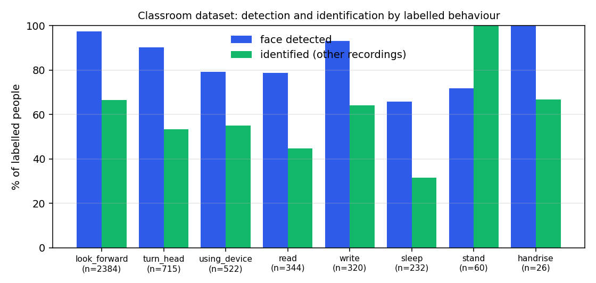

| Labelled behaviour | People | Face detected | Identified, unseen recordings |
|---|---|---|---|
| Looking forward | 2384 | 97.4% | 66.4% |
| Turning head | 715 | 90.1% | 53.4% |
| Using a device | 522 | 79.1% | 55.1% |
| Reading | 344 | 78.8% | 44.8% |
| Writing | 320 | 93.1% | 64.0% |
| Sleeping (head down) | 232 | 65.9% | 31.6% |
| Standing, hand raised | 86 | 80.2% | – |
| **All** | **4603** | **90.6%** | **59.3%** |

"Identified" is bounded well below 100% because several people in each room are not enrolled
(for example six of about eight in class B), and each class was enrolled from one recording only.

This evaluation exposed a defect and guided three changes:

| Setting | Face detected | Identified, unseen recordings | Wide, soft recording: identified |
|---|---|---|---|
| Initial (thresholds 0.40 / 0.35, blur cut-off 8, 5 photos) | 82.3% | 52.5% | 27.9% |
| Blur cut-off 4, thresholds 0.35 / 0.32 | 90.6% | 58.0% | 40.4% |
| ... and 10 enrolment photos per student | 90.6% | 59.3% | 42.5% |

With the initial settings the full pipeline detected fewer people than a plain full-frame pass
(82.3% against 87.2%): the blur filter was discarding soft but usable faces. With the cut-off
lowered, the pipeline beats the plain pass, as intended. Per recording:
[dataset_by_recording.csv](dataset_by_recording.csv).

The behaviour breakdown is the practical lesson: a student who looks at the board is found
97% of the time in any single frame; one with their head down, about two thirds. Over a whole
class the persistence rule (three sightings spread over the session) absorbs this.

## 5. Attendance logic

- **Gallery restriction.** Only the students of the batch scheduled in that room are compared,
  which shrinks the gallery and removes most chances of a wrong match.
- **Match.** Best similarity ≥ 0.35 (0.32 when the crop's Laplacian variance is under 60), and
  at least 0.06 above the second-best student. Per frame, a student is given to at most one
  face — the one with the highest similarity.
- **Decision.** The observed class time is split into 10 buckets.
  Present: ≥ 3 sightings in ≥ 30% of the buckets. Late: the same, but first seen more than
  10 minutes after the start. Absent: otherwise.
- **Unknown faces** are grouped per person (running-mean embedding, merge at similarity 0.40) and
  saved with a snapshot; single stray detections are dropped.
- **Output.** One best snapshot per student, an Excel workbook (attendance, summary, unknown
  faces) and a CSV per session.

## 6. Results on real footage

`python scripts/rebuild_demo_sessions.py --yes` re-runs every session below.

| # | Footage | Enrolled from | Students | Present | Late | Absent |
|---|---|---|---|---|---|---|
| 1 | University class A, recording 2 | recording 1 | 12 | 12 | 0 | 0 |
| 2 | University class A, recording 3 (wide, soft shot) | recording 1 | 12 | 9 | 0 | 3 |
| 3 | University class B, recording 3 | recording 2 | 6 | 5 | 0 | 1 |
| 4 | University class B, recording 4 | recording 2 | 6 | 5 | 0 | 1 |
| 5 | University class B, recording 5 | recording 2 | 6 | 5 | 0 | 1 |
| 6 | Class B, recordings 3+4+5 as a 40-min time-lapse, one late arrival simulated | recording 2 | 6 | 4 | 1 | 1 |
| 7 | Exam-hall CCTV, last 42 s | first 30 s | 7 | 7 | 0 | 0 |
| 8 | Seminar audience, last 124 s | first 60 s | 14 | 12 | 1 | 1 |
| 9 | Public test clip | separate portraits | 5 | 2 | 0 | 3 |

With the initial thresholds the same sessions gave 8, 4 and 6 Present in rows 2, 3 and 7.


*Session 1: every enrolled student recognised in a different recording of the same class.*


*Session 7: overhead CCTV, faces about 25 px and mostly looking down.*

Notes on reading this table:

- In sessions 1–6 the class was enrolled from one recording and tested on **different
  recordings**, which is the realistic case. Sessions 7 and 8 use two parts of the same recording.
- There is no register of who attended each recording, so an "Absent" may be a true absence or a
  miss. Session 2 (a wide, soft shot) still under-counts: students there were matched a few
  times but stayed under the Present rule. One class-B student is Absent in every recording
  after the enrolment one and may simply not be there.
- Session 6 joins three separate recordings into one 40-minute class to exercise the Late rule
  at its real 10-minute threshold. The late arrival is simulated: one student's face is hidden
  for the first 13 minutes, and they are first seen at 13 min 20 s.
- In session 8 the Late student is also simulated (face blurred for the first 75 s, threshold
  lowered to 1 minute) and the Absent student is enrolled from photos of a person who is not in
  that footage.
- Student names in the demo are invented (initial and surname): the people in the public footage
  are not identified. They are applied from `data/demo_names.csv`.
- In session 9 one enrolled person appears briefly in the audience (5 sightings in 2 of 10 time
  buckets) and is correctly left Absent by the persistence rule; the pianist, seen in 3 buckets,
  is Present.

**Live mode** was run on the laptop webcam (enrolled user Present in 15 of 15 frames, best
similarity 0.77), on a UDP network stream and on an RTSP stream (13 Present, 1 Absent on the
seminar class).

**Speed** for one 1080p frame with tiling (7 detector passes, 9 faces embedded): 0.36 s on the
GTX 1050 against 1.99 s on CPU. At one frame every 3 s both are faster than real time.

## 7. Testing

`python -m pytest` runs 99 automated tests in about a minute and a half.

| Area | Tests | What is checked |
|---|---|---|
| Image processing | 18 | gamma trigger and clamp, intensity transforms, CDF and equalisation, noise models and PSNR, median vs linear vs bilateral filters, Laplacian and Sobel, DFT spectrum and frequency filters, interpolation, LAB colour, CLAHE vs global HE, unsharp, blur score, tile coverage |
| Timetable and database | 14 | slot lookup and boundaries, midnight-crossing slots, CSV round trip, batch-restricted gallery, cascade deletes |
| Attendance rules | 22 | Present / Late / Absent at each boundary, thresholds, margin, one-face-per-student, unknown merging, export, virtual clock, time-lapse |
| Real models | 11 | alignment maths, NMS, face counts, landmarks, same / different person scores, small faces, tiled detection, enrolment, an end-to-end recorded session |
| Syllabus operations | 25 | sampling and quantization, homomorphic filter, PSFs, inverse and Wiener filtering, pseudo-colour, Huffman / arithmetic / LZW round trips against entropy, JPEG tables and DCT, erosion to skeletons, head count, point / line / edge masks, Otsu against OpenCV, region growing, Hough peaks, contours |
| Dashboard | 9 | every page loads; all 20 DIP Lab topics render; navigation, roster search, add / delete student, re-enrol, save timetable and cameras, run a session, reports, delete session |

The attendance rules are tested with a scripted fake face engine, so each rule is checked exactly
rather than inferred from footage. Writing the suite found and fixed a real defect: class slots
running past midnight were never matched.

## 8. Limitations

- **No attendance register.** Recognition is measured on LFW and detection against the classroom
  dataset's person labels, but no source says which named student attended which class, so
  final Present / Absent decisions are checked by inspection.
- **Thresholds were tuned on LFW**, whose faces are mostly frontal press photographs. The
  false-accept rates in section 4.1 may be higher on a classroom camera.
- **Live cameras.** No IP camera was available: RTSP was verified with a software stream source
  only, and the live path with one laptop webcam.
- **Enrolment in the demo comes from video**, clustered automatically. Real use needs 3–5 photos
  per student, and accuracy on photo-enrolled students seen through a classroom camera was only
  tested for one person on a webcam.
- **Face size.** Below about 20 px recognition degrades, and faces turned away or looking down
  are missed. Camera placement (front of the room, 1080p or better) matters more than any filter.
- **No liveness check**: a printed photo held to the camera would be accepted.
- **Several syllabus techniques did not improve attendance.** Homomorphic filtering did not raise
  detection, the morphological head count is unreliable, and restoration needs a known blur.
  They are implemented, measured and demonstrated, but the pipeline does not depend on them.
- **Privacy**: face data is biometric. Consent, retention and access rules are needed before use
  on real students.

## 9. Data and model sources

- InsightFace `buffalo_l` models (SCRFD-10G, ArcFace R50 trained on WebFace600K), release v0.7.
- Labeled Faces in the Wild (LFW), University of Massachusetts Amherst.
- Classroom Student Engagement Dataset, Ghulam Mustafa, Kaggle, CC BY-NC 4.0.
- "Altima IP Camera Class Room" and "Virtual Reality (VR) Public Speaking Practice Stage:
  Audience of 100", YouTube.
- Example images and clip from the `ageitgey/face_recognition` repository.
